<p align="center">
  
</p>

<p align="center">
  A lightweight, performant pinch-to-zoom, pan, and double-tap zoom container for React Native. Powered by <b>react-native-gesture-handler</b> and the built-in <b>Animated</b> API — no Reanimated required.
</p>

<p align="center">
  <a href="LICENSE"></a>
  <a href="https://www.npmjs.com/package/react-native-zoom-anything"></a>
  <a href="https://www.npmjs.com/package/react-native-zoom-anything"></a>
  = 0.69">
  
  <a href="https://github.com/douglasjunior/react-native-zoom-anything/pulls"></a>
</p>

<p align="center">
  <a href="#-quick-start"><b>Quick Start</b></a> ·
  <a href="#-why-react-native-zoom-anything">Why</a> ·
  <a href="#-live-demo">Live Demo</a> ·
  <a href="#-how-it-works">How It Works</a> ·
  <a href="#-basic-usage">Usage</a> ·
  <a href="#-props">Props</a> ·
  <a href="#-contributing">Contributing</a> ·
  <a href="#-license">License</a>
</p>

---

## 🚀 Quick Start

Install `react-native-zoom-anything` and its peer dependency `react-native-gesture-handler`:

```bash
# npm
npm install react-native-zoom-anything react-native-gesture-handler

# yarn
yarn add react-native-zoom-anything react-native-gesture-handler

# bun
bun add react-native-zoom-anything react-native-gesture-handler
```

> **Requirements:**
> - `react-native >= 0.69.0`
> - `react-native-gesture-handler >= 2.0.0`
>
> Follow the [react-native-gesture-handler installation instructions](https://docs.swmansion.com/react-native-gesture-handler/docs/installation) for your React Native version to ensure native gesture handlers and root view wrappers are configured.

---

## 💡 Why react-native-zoom-anything?

- 🔍 **Pinch-to-Zoom**: Fluid multi-touch scaling between customizable `minZoom` and `maxZoom` thresholds.
- 👆 **Double-Tap Cycle**: Instant animated toggle between `minZoom` → midpoint (`(minZoom + maxZoom) / 2`) → `maxZoom` → `minZoom` around the tapped focal point.
- ✋ **Clamped Pan with Momentum**: Pan smoothly around zoomed content with strict container boundary clamping and cubic inertia projection.
- 🪶 **Zero Reanimated Dependency**: Built strictly on React Native's core `Animated` API using `useNativeDriver: true`. No extra native bridges or TurboModule setup required.
- 🧵 **Flexible Threading**: Defaults to `runOnJS={true}` for zero-setup execution, with optional native thread support when Reanimated is present.
- 📦 **Unopinionated Container**: Wrap any component that accepts `onLayout`—images, SVG charts, canvases, or layout views.

---

## 📱 Live Demo

Try the interactive demo live in your browser or mobile device via [Expo Snack](https://snack.expo.dev/@douglasjunior/react-native-zoom-anything):

| Android | iOS |
| :---: | :---: |
|  |  |

---

## 🧠 How It Works

`react-native-zoom-anything` composes three simultaneous gesture recognizers from `react-native-gesture-handler`:

```text
Gesture.Simultaneous(Pinch, Pan, Tap(2))
```

1. **Simultaneous Recognition**: The `Pinch`, `Pan`, and double `Tap` gestures run simultaneously without intercepting each other.
2. **Boundary Clamping**: As content scales, `computePanBounds()` calculates dynamic pan boundaries (`minX`, `maxX`, `minY`, `maxY`) based on the measured container and content dimensions.
3. **Double-Tap Focal Calculation**: Double-tapping calculates the ratio between current scale and target scale relative to the tap position, ensuring the zoom zooms directly towards where the user tapped.
4. **Native Driver Animations**: Scale and translation transitions utilize `Animated.parallel` with `useNativeDriver: true` for 60 FPS transitions.

---

## 💻 Basic Usage

Wrap your target view or image in `<Zoom>`:

```tsx
import React from 'react';
import { Image, useWindowDimensions, View } from 'react-native';
import { GestureHandlerRootView } from 'react-native-gesture-handler';
import Zoom from 'react-native-zoom-anything';

export default function Example() {
  const { width } = useWindowDimensions();

  return (
    <GestureHandlerRootView style={{ flex: 1 }}>
      <Zoom minZoom={1} maxZoom={5} style={{ flex: 1, backgroundColor: '#000000' }}>
        <Image
          source={{ uri: 'https://picsum.photos/1920/1080' }}
          style={{ width, height: (width * 9) / 16 }}
          resizeMode="contain"
        />
      </Zoom>
    </GestureHandlerRootView>
  );
}
```

> [!NOTE]
> If your application root is already wrapped with `<GestureHandlerRootView>`, you do not need to wrap `<Zoom>` with another one.

---

## ⚙ Props

The `<Zoom>` component accepts the following props:

| Prop | Type | Default | Description |
|---|---|---|---|
| `children` | `React.ReactElement<{ onLayout: ViewProps['onLayout'] }>` | `undefined` | A single React element that accepts `onLayout` (e.g. `<Image />` or `<View />`). For multiple elements, wrap them in a single `<View>`. |
| `minZoom` | `number` | `1` | Minimum zoom scale threshold. |
| `maxZoom` | `number` | `5` | Maximum zoom scale threshold. |
| `style` | `ViewProps['style']` | `undefined` | Optional styles applied to the outer container `<View>`. |
| `runOnJS` | `boolean` | `true` | When `true`, gesture callbacks run on the JavaScript thread without requiring `react-native-reanimated`. When `false`, gestures execute on the native UI thread (requires `react-native-reanimated`). |

---

## 🤝 Contributing

Contributions are warmly welcomed! For questions, bug reports, or feature suggestions, feel free to open an [issue](https://github.com/douglasjunior/react-native-zoom-anything/issues).

1. Fork the repository and create your topic branch (`git checkout -b feat/my-improvement`).
2. Verify that TypeScript type checks pass (`yarn build`).
3. Commit your changes using [Conventional Commits](https://www.conventionalcommits.org/) in English (e.g. `feat(zoom): add focal lock option`).
4. Push your branch and open a Pull Request against `main`.

---

## ⭐ Star History

If `react-native-zoom-anything` helped streamline your gestures, consider giving it a star on GitHub:

<p align="center">
  <a href="https://star-history.com/#douglasjunior/react-native-zoom-anything&Date">
    <picture>
      <source media="(prefers-color-scheme: dark)" srcset="https://api.star-history.com/svg?repos=douglasjunior/react-native-zoom-anything&type=Date&theme=dark">
      
    </picture>
  </a>
</p>

---

## 📄 License

[MIT](LICENSE) © 2025 Douglas Nassif Roma Junior

---

## 🌐 Author & More Projects

<p align="center">
  <a href="https://douglasjunior.work">
    
  </a>
</p>

<p align="center">
  Discover more open-source libraries, creative animation engines, and developer tools at <a href="https://douglasjunior.work"><b>douglasjunior.work</b></a>.
</p>
